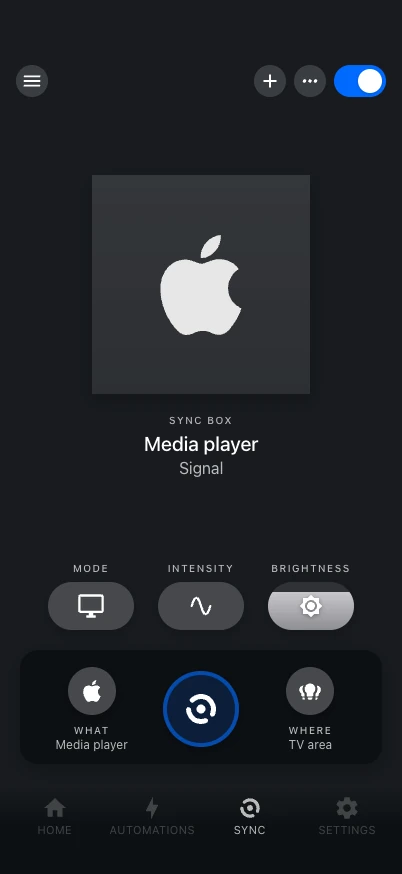

# Hue Play HDMI Sync Box

There are two ways to use a Sync Box with Hue Studio. You choose when you add it, and one
box is only ever set up one way.

{ .shot }

Add it under **Settings → Devices & services → Add integration → Hue Studio → Hue Play
HDMI Sync Box** (or accept the discovered device), then pick one of the two modes.

## Pair directly (recommended)

Hue Studio talks to the box itself (its local API, through
[aiohuesyncbox](https://github.com/mvdwetering/aiohuesyncbox)) and pairs with its button:
hold the button on the box for about 3 seconds when asked. This mode has every feature,
and new Sync Box features in Hue Studio are built for it.

It brings its own [entities](../reference/entities.md#sync-box): power and light sync
switches; sync mode, intensity, HDMI input, entertainment area and LED selects;
brightness; HDMI port, content, bridge connection and Wi-Fi sensors. Entity ids and option
values match the HACS [Hue Sync Box integration](https://github.com/mvdwetering/huesyncbox)
(`switch.sync_box_light_sync`, `select.sync_box_hdmi_input` with your input names, …), so
automations keep working when you switch over: remove the box from that integration
first, then add it to Hue Studio.

Only in this mode:

- the music palette and background lighting;
- presets of the box;
- remote buttons: any infrared remote can be taught to start syncing, switch modes or
  inputs, or apply a preset;
- the box's settings as in the Hue app: name, status light, inputs' names and types, the
  TV, turning on and off with it (HDMI CEC, hot plug, USB, inactivity), updates at night,
  restart;
- following the picture: Hue Studio can act as the box's HDMI CEC, for sources that have
  none (a PC behind an EDID manager, for example), switching inputs and waking the box
  and the TV from Home Assistant entities.

## Compatibility mode: through the Sync Box integration

Already using the HACS Hue Sync Box integration and want to keep it? Hue Studio can work
through it instead: nothing to pair and no entities of Hue Studio's own. It reads that
integration's entities and controls the box with its `huesyncbox.set_sync_state`
service. The panel, the Sync tab and
[`hue_studio.set_sync`](../reference/services.md#set_sync) work the same. When you
discover or try to pair a box that the integration already has, Hue Studio offers this
mode.

Limits, because Hue Studio only sees what that integration exposes:

- entertainment areas are matched with the bridge by name (a renamed area needs the
  integration to pick up the new name);
- input types (the icons of HDMI inputs) and whether the current content can be synced
  are not available;
- new Sync Box features of Hue Studio need direct pairing;
- if the integration changes what it exposes, the affected parts show as unavailable.

To switch to direct pairing later, remove the box from the Sync Box integration and add
it to Hue Studio again.

## In both modes

- **Panel:** a Sync tab like in the Hue app, a Sync card in rooms whose lights the box
  syncs, and no scenes on those lights while it syncs.
- **[`hue_studio.set_sync`](../reference/services.md#set_sync):** one service for both
  modes (target any entity of the box).
- **Bridge link:** the box's entertainment areas are matched with the bridge, so Hue
  Studio knows which lights are synced; when streaming starts or stops, the bridge pushes
  it at once.

Both Hue Studio and the Sync Box integration need aiohuesyncbox. Hue Studio accepts any
0.1.x release from 0.1.6 on, so the two share one copy.
