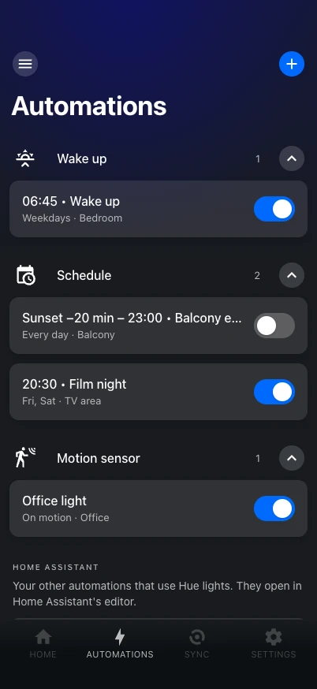
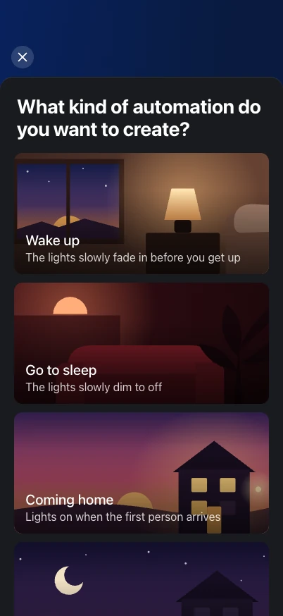
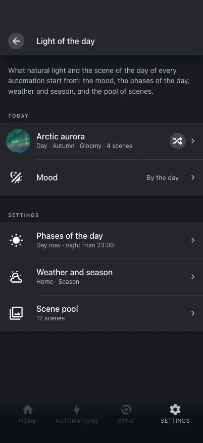

# Automations

{ .shot }
{ .shot }

The **Automations** tab has the Hue app's automations:

| Type | What it does |
|---|---|
| Wake up | The lights fade in and are fully on at the wake-up time, or with sunrise. |
| Go to sleep | From the set time, or a press of a Hue button, the lights slowly dim to off. |
| Coming home | The lights go on when the first person arrives. |
| Leaving home | The lights go off when the last person leaves. |
| Mimic presence | While nobody is home, rooms and zones go on and off at random in a time window. |
| Schedule | The lights go on at a time, at sunrise or at sunset, and optionally off later. |
| Motion sensor | Motion turns the lights on when it is dark enough; they go off when nobody moved for a while. |

## They are Home Assistant automations

Each one is a **Home Assistant automation** made from a [blueprint](../reference/blueprints.md)
that Hue Studio puts in place. Home Assistant stores and runs it, lists it in Settings →
Automations and edits it with a form; **Open in Home Assistant** is one tap away. There is
no automation engine of Hue Studio's own.

- An automation works in **rooms** (Home Assistant areas) and **zones** (Hue rooms and
  zones that no area holds, or single Hue lights). The tab lists them by room and zone;
  each room's or zone's screen shows its own with their switches.
- The panel also lists your other automations that use Hue lights.
- Automations made in Hue Studio get the "Hue Studio" label and automation category and
  the area of their room (your own choices are kept); their description links back to the
  panel.
- Editing them needs a Home Assistant administrator; everyone can switch them on and off.

Times are picked on wheels, like the Hue app's "Start at": a time, sunrise or sunset
(with an offset), or none.

Coming and leaving home need Home Assistant to know who is home: a new one first shows a
checklist (the home zone, people whose phone shares its location "Always") until it does.

## The light

The light of an automation is one of:

- **a scene** per room;
- **a white** (color temperature and brightness);
- **natural light** — a white per phase of the day, cool in the morning, warm in the
  evening, like the Hue app's;
- **the scene of the day** — a gallery scene picked by phase of the day, season, weather
  and mood, with a brightness that follows the light outside;
- **off**.

Once shown, natural light and the scene of the day keep up with the day until someone
changes the lights or turns them off.

## The light of the day

{ .shot }

Natural light and the scene of the day start from the **light of the day** (Settings →
Light of the day), shared by every automation:

- **The scene pool.** Every gallery scene has tags — the phases of the day, seasons,
  weather (clear or gloomy) and moods it fits. Hue Studio ships ready-made tags for the
  whole gallery, so the scene of the day works out of the box; change any scene's tags,
  take it out of the pool, or turn the ready-made tags off and build your own pool.
- **The mood** (relax, cozy, focus, romantic, party, festive, or "by the day"). A mood
  picks from its own scenes instead, in every automation at once. It is an entity,
  [`select.hue_studio_mood`](../reference/entities.md#hue-studio), so dashboards and
  automations can set it too.
- **The phases of the day.** When morning, day, golden hour and evening start (minutes
  from sunrise and sunset) and when the night starts.
  [`sensor.hue_studio_phase`](../reference/entities.md#hue-studio) shows the phase, with
  the season and weather as attributes.
- **Weather, season and a light sensor**, picked automatically when Home Assistant has
  them. Without a weather entity the panel offers to add Met.no, without the Season
  integration to add it (until then the month decides).

An automation only adds what is its own: extra or skipped scenes, its own phase times,
brightness per phase and the white of natural light.

!!! note "Automations from before 0.10"
    They had pools of their own. The panel moves them into the shared pool once (the
    ready-made tags are then off, so the pool is what you had put together) and saves the
    automations without them.

## Motion sensors

A motion sensor's **Turn off after** is a slider, and its minutes may differ by part of
the day. Its light level comes from the sensor's own light sensor, and so does its daytime
brightness.

## From your own automations

[`hue_studio.apply_light`](../reference/services.md#apply_light) shows any of these lights
from your own automations and scripts, and keeps natural light and the scene of the day
up with the day.
