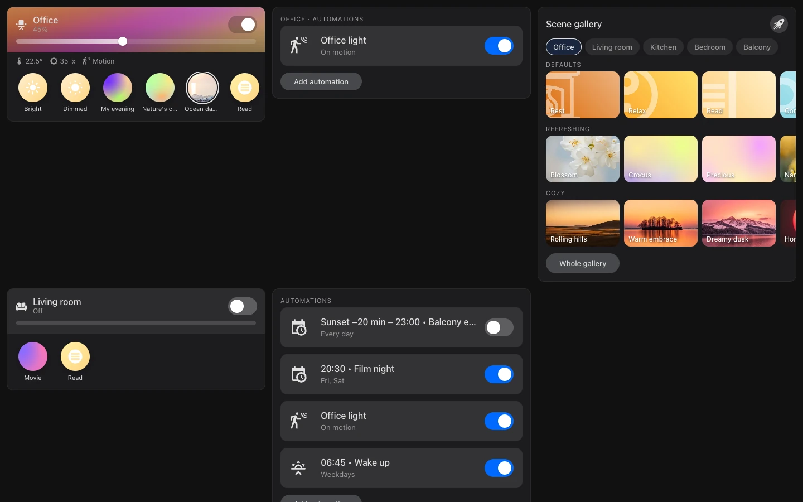
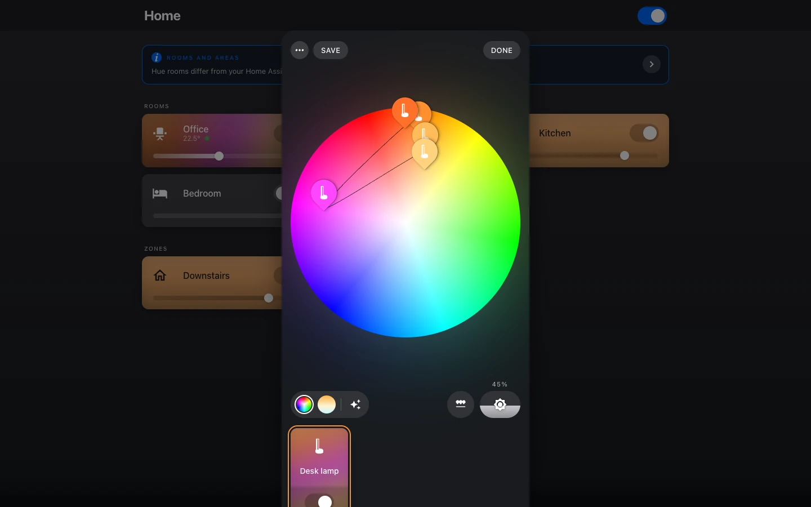

# Dashboard cards

Hue Studio registers its own frontend: nothing to add under dashboard resources.

{ .shot }

## Cards

Three cards for regular dashboards, in the card picker with a visual editor:

| Card | What it shows |
|---|---|
| `custom:hue-studio-room-card` | A room (`area`): toggle, brightness, sensors, its Hue scenes. |
| `custom:hue-studio-automations-card` | Hue Studio's automations (of an `area`) with their switches; **+** adds one. |
| `custom:hue-studio-gallery-card` | Gallery scenes to show once in a room (`area`, or room chips limited by `rooms`; `categories`). |

They follow your theme's colors.

```yaml
type: custom:hue-studio-room-card
area: living_room
```

## The Hue-style dialog

{ .shot }

Opening a Hue light from any card (tile, Mushroom, Bubble Card, …) shows Hue Studio's
dialog with the color wheel. A Hue scene opens a Hue-style sheet, and an automation made
with Hue Studio opens a sheet with its switch, a summary, **Edit** and **Open in Home
Assistant** (for administrators). Everything else opens Home Assistant's own dialog.

The dialog's **Details** button opens Home Assistant's dialog for the same entity
(history, settings, related).

!!! info "Always a way back"
    If Hue Studio's frontend fails to load or crashes, Home Assistant shows its stock
    dialog: you never lose access to a light because of Hue Studio.
