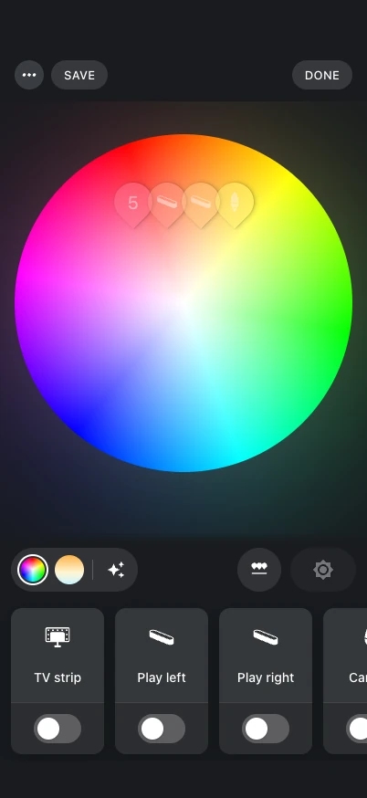

# Lights and colors

{ .shot }

Tap a room's or a light's color to open the **color wheel**. Each light is a dot (a pin)
you drag; the room's lights move together or one at a time.

## Gamut

Hue lights have different color gamuts (A, B or C). A point on the wheel is clipped to the
gamut of that specific light, so the color on screen is the color the light can show.

## Gradient lights

Gradient lights (light strips, Signe, Festavia, …) always show as many pins as they have
color points, as in the Hue app.

- Pins with the same color are drawn as one pin with a count — a uniform gradient, or
  pins merged by dropping one on another.
- Tap a merged pin to spread its pins around a disc and pull one out.
- **Gradient styles** pick how the light lays its colors out: blended, mirrored,
  scattered (random pixels) or in segments, as far as the light supports them.

## White

The white mode picks a color temperature, from warm to cool, on the same screen.

## Effects

Light effects — candle, fireplace, sparkle, glisten, opal, prism, underwater, cosmos,
sunbeam, enchant — each with its own color, brightness and speed (12 steps, as in the Hue
app). An effect's **Adjust** opens its settings.

## Lights that are syncing

While an entertainment area streams to a light (a Sync Box, PC or TV sync), the stream
would overwrite any color anyway, so scenes, palettes, gradients and effects leave those
lights alone.

## Light icons

Light icons are the Hue app's: a light's shape picked in the Hue app (its archetype),
refined by its product name, picks the icon. An icon you set in Home Assistant's entity
settings wins.

## From automations and scripts

The same things are available as services:
[`apply_palette`](../reference/services.md#apply_palette),
[`set_gradient`](../reference/services.md#set_gradient) and
[`set_effect`](../reference/services.md#set_effect).
