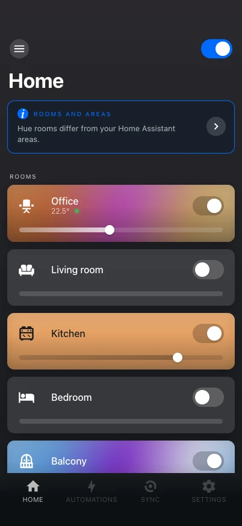

# The panel

**Hue** in the sidebar (`/hue`) opens a full-screen panel laid out like the Hue app, but
built on Home Assistant's own model: its rooms are your areas, its controls are
`light.turn_on` and `scene.turn_on` where Home Assistant can do the job, and every
setting is read and written through the integration — nothing to edit in YAML.

{ .shot }
{ .shot }

## Tabs

| Tab | What is there |
|---|---|
| **Home** | Rooms and zones, each with its switch and brightness. A banner shows when the Hue rooms on the bridge differ from your areas. |
| **Automations** | The Hue app's automations, by room and zone, plus your other automations that use Hue lights. See [Automations](automations.md). |
| **Sync** | The Hue Play HDMI Sync Box, shown once a box is set up. See [Sync Box](../getting-started/sync-box.md). |
| **Settings** | Devices, bridges, MotionAware and entertainment areas; rooms and zones, the scene gallery, the light of the day and integration settings. See [Settings](settings.md). |

## Rooms

A **room** is a Home Assistant area that contains Hue lights (through the light's device
or the entity itself). Its name and icon are the area's.

- If a Hue room or zone covers exactly the same lights, it is the room's command target:
  one bridge command instead of one per light, and its scenes are the room's scenes.
- Otherwise commands go to the room's lights, and scenes of Hue groups lying inside the
  area are offered.

A room's screen shows its scenes (two rows that scroll sideways, then the scene gallery
and a suggested scene), its lights, the zones that lie in it, its sensors (temperature,
light level, a card per Hue sensor) and its automations. The **+** in its header adds a
scene, an automation or a device.

## Zones

A **zone** is a Hue room or zone that is not any room's own command target. Every such
Hue zone is on Home, and a room lists the zones lying in it after its lights. Zones are
created and edited under [Rooms and zones](rooms-and-zones.md).

## Commands feel instant

Every command shows its expected result at once and falls back to the real state if the
bridge reports an error or does not confirm within 5 seconds. Dragging on the color wheel
is throttled to the bridge's limits (about 10 commands per second for a light, 1 per
second for a group), and several lights at once go through a group command or a scene.

## Phone and desktop

The panel works on phones (including Home Assistant's companion apps, with their safe
areas and haptics) and on desktops. On a phone, sheets rise from the bottom, as in the Hue
app.

## Who can do what

Everyone with access to Home Assistant can use lights, scenes and switch automations on
and off. Settings, editing automations, and services that delete or reshape things on the
bridge need a Home Assistant administrator.
