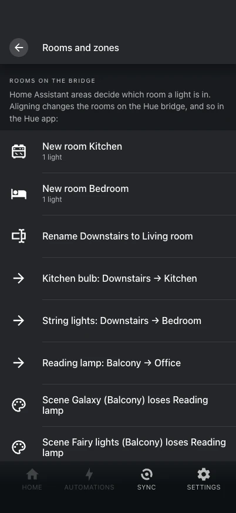

# Rooms and zones

Home Assistant areas decide which room a light is in; the Hue bridge (and so the Hue app)
follows.

{ .shot }

## Aligning Hue rooms with your areas

**Settings → Rooms and zones** shows how the Hue rooms on the bridge differ from your
areas — rooms to create or rename, lights to move, scenes that lose or gain lights — and
aligns them when you confirm.

- A light moved in the Hue app shows up in its room with **move in Home Assistant** or
  **move back in Hue**.
- Hue lights without an area are listed under **No room**, with an area picker.
- With **Rooms follow areas** on (Settings → Integration settings), every area change is
  written to the bridge at once.
- A room's scenes get settings for lights that joined it; a room split over several areas
  can keep its scenes in a new zone over all its lights.

The same is available as
[`hue_studio.align_rooms`](../reference/services.md#align_rooms), with a dry run that only
returns the plan.

## Several bridges

An area lives on one bridge. Hue Studio moves rooms, zones and lights that change room
within a bridge; moving a whole home to another bridge is done in the Hue app.

## Zones

Zones (any lights from any rooms) are created and edited on the same screen: name and
lights. A zone gets scenes of its own, like a room.

## Zones as labels

With **Zones as labels** on (Settings → Integration settings, off by default), every Hue
zone is also a Home Assistant label `Hue zone: <name>` on its lights, kept alike both ways.
The zone stays on the bridge, so the Hue app always shows it right, and it appears in Home
Assistant only once, as its Hue light group; the label lets automations, scripts and
templates (`label_entities()`) use it.

- A zone made, renamed or given other lights in the Hue app or the panel changes its
  label; the label renamed or put on other Hue lights in Home Assistant changes the zone.
  A new label `Hue zone: <name>` on Hue lights makes that zone. When both sides changed at
  once, the bridge wins.
- Nothing is deleted behind your back: deleting the label leaves the zone (and its scenes)
  on the bridge, and the Rooms and zones screen offers to delete it or label it again; a
  label taken off every light keeps its zone. A zone deleted on the bridge takes its label
  with it.
- Lights that cannot join (not Hue lights, or on another bridge) keep the label and are
  listed on the Rooms and zones screen. Only labels on entities count, not on devices.

## For the curious

The design behind this — the two models, what the native integration already syncs and
what Hue Studio adds — is in [Rooms and scenes design](../rooms-and-scenes.md).
