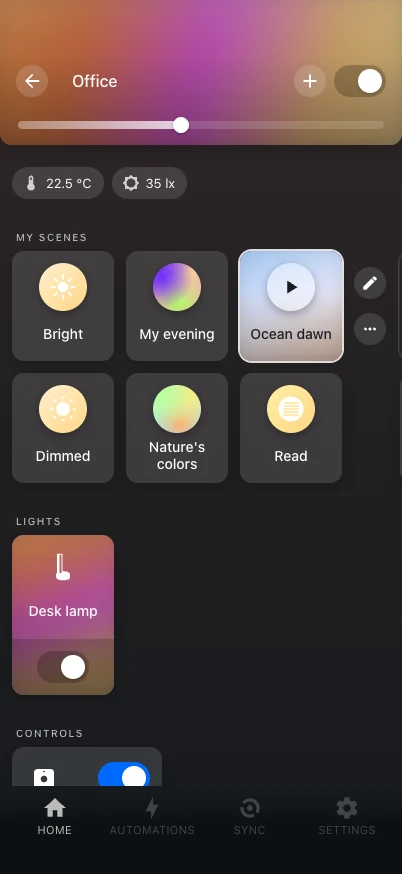
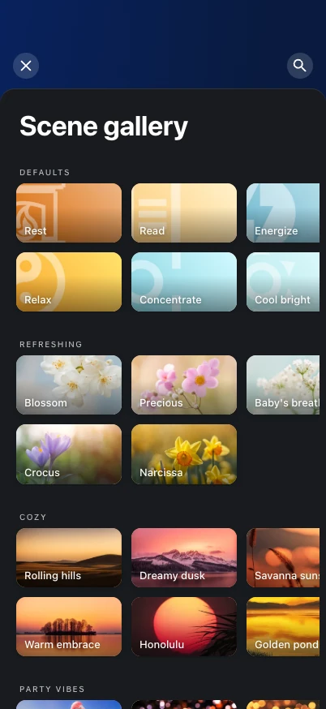

# Scenes and gallery

{ .shot }
{ .shot }

## Where scenes live

Everything the Hue app can show lives on the bridge. A scene saved in a room is a bridge
scene in that room's Hue room or zone, with its colors kept as a palette, so the Hue app
sees and edits it, and changes from either side reach the other through the bridge. There
is no copy to keep in sync. Only what the bridge cannot hold — such as a photo of your own
for a scene — is kept by Hue Studio.

## A room's scenes

A room shows its scenes in two rows that scroll sideways, as in the Hue app.

- Tap a scene to show it. The active one shows **play/stop** for a dynamic scene, an
  **edit** button and **⋯**: copy to another room, dynamic speed, shuffle colors, delete.
- After the scenes: the scene gallery and a **suggested scene** — a scene of the day by
  phase, season and weather, which you can shuffle.
- A light playing a dynamic scene says "Dynamics", and its card's colors drift at the
  scene's speed.

## The gallery

The gallery has 142 scenes, grouped like the Hue app's (defaults, refreshing, cozy, …),
with a seasonal selection. A scene's sheet shows its picture, name and colors (shuffle
them), the room or zone to use it in, and two actions:

- **Set once** — show it now without saving anything. With light positions set up (see
  [Space](space.md)), it offers **Classic** or **Spatial**: spatial spreads the colors
  along the room.
- **Save to my scenes** — save it as a scene of that room or zone on the bridge.

Gallery pictures are the Hue app's own, downloaded once by Home Assistant into its cache;
until then a bundled stand-in shows. The scene gallery's own settings are under
**Settings → Scene gallery**.

## Your own scenes

**+ → Scene** in a room (or **edit** on a scene) opens the scene editor: name, icon (the
Hue app's scene glyphs) or a photo of your own, the lights' colors on the wheel, the
dynamic speed and auto-play. Save captures what the lights show; reset rebuilds the
scene from its palette.

A scene's sheet can **Share** it as a scene link, and a link shared from the Hue app or
Hue Studio can be opened as a new scene.

## Scenes in Home Assistant's lists

With **Organize in Home Assistant** on (Settings → Integration settings), bridge scenes
get a "Hue Studio" label (and "Hue custom scene" for scenes of your own), a category per
Hue room or zone with its icon, and the area of their room. Choices you make yourself in
Home Assistant are kept. Opening a Hue scene anywhere in Home Assistant shows a Hue-style
sheet.

## Backups

[`hue_studio.export_scenes`](../reference/services.md#export_scenes) writes the bridge
scenes to a file in `<config>/hue_studio/scenes/`, so Home Assistant's own backups hold
them; lights are saved by their Zigbee address, so a scene can come back even after a
light was paired again. Call it nightly from an automation, before Home Assistant's
backup.

To restore, use **Settings → Integration settings → Scene backup** in the panel, or
[`hue_studio.import_scenes`](../reference/services.md#import_scenes).
