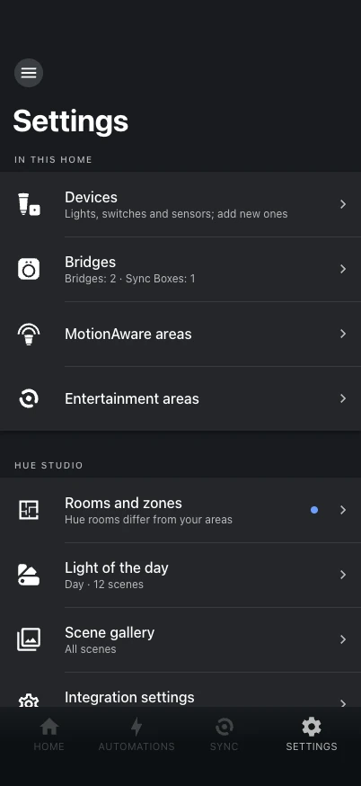

# Settings and devices

{ .shot }

The panel's **Settings** tab is laid out like the Hue app's. Every setting of Hue Studio
is here: the integration has no options dialog in Home Assistant's settings, and there is
no YAML to write.

## In this home

- **Devices** — every Hue device by area, and adding new ones (below).
- **Bridges** — every bridge and Sync Box as a row of its own, each opening its page: a
  bridge's name, facts, devices and MotionAware areas; a Sync Box's name, status light,
  turning on and off with the TV, and how it is connected. New bridges are found on the
  network and linked through the Philips Hue integration (its button).
- **MotionAware areas** — health, on/off, create, recalibrate, what motion does; shown
  only with a Hue Bridge Pro.
- **Entertainment areas** — create, rename, change type and lights, arrange where the
  lights stand, delete. They are not rooms or zones.

## Hue Studio

- **Rooms and zones** — see [Rooms and zones](rooms-and-zones.md).
- **Scene gallery** — the gallery's own settings.
- **Light of the day** — see [Automations](automations.md#the-light-of-the-day).
- **Integration settings** — rooms follow areas, which area each Hue room or zone belongs
  to, the sensors of each room, zones as labels, organizing scenes in Home Assistant,
  scene backup.
- **Experimental** — features that are still taking shape. There are none right now.

## Adding devices

**Settings → Devices → Add devices** (or a room's **+ → Device**), like the Hue app:

1. Pick what you add: Hue lights, accessories, or Zigbee lights of other brands where the
   bridge allows it.
2. Follow the steps to get it ready.
3. The bridge searches for about a minute — optionally by the serial numbers printed on
   the devices, for devices from another bridge or far away. Devices show up as they
   join. Install codes can be scanned from QR codes where the bridge takes them.
4. Each new device gets a name (on the bridge, so the Hue app shows it too) and a room — a
   Home Assistant area, or a new one created on the spot. A light also moves into the Hue
   room of that area.

**Identify** makes a light breathe or a sensor blink. Any Hue device can later be renamed,
moved to another area or deleted from its bridge (Home Assistant then removes its device).

A device that comes back as a new device on the bridge — added again, reset, or paired in
the Hue app — gets its old entity ids and settings back once the old entities are gone.

## Hue sensors

A room shows a card for each Hue sensor with its on/off and its settings: name, room,
lights, and motion sensitivity, tried out live while it calibrates.
