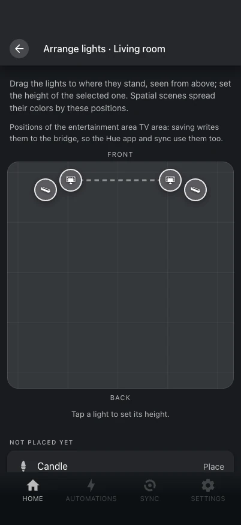

# Space

Where lights stand drives spatial scenes, like the Hue app's SpatialAware, but without a
Bridge Pro.

{ .shot }

- Positions come from your entertainment areas, as the Hue app placed the lights.
- A room's **Arrange** screen shows them from above: drag lights to where they stand and
  set the height of the selected one.
- Lights of an entertainment area are saved back to the bridge, so the Hue app and sync
  use the same positions; the rest are kept by Hue Studio.

**Set once** in the gallery then offers **Classic** or **Spatial**: spatial spreads the
scene's colors along the room. From automations, use
[`apply_palette`](../reference/services.md#apply_palette) with `layout: spatial`.

Entertainment areas themselves (create, rename, change type and lights, arrange, delete)
are under **Settings → Entertainment areas**.
