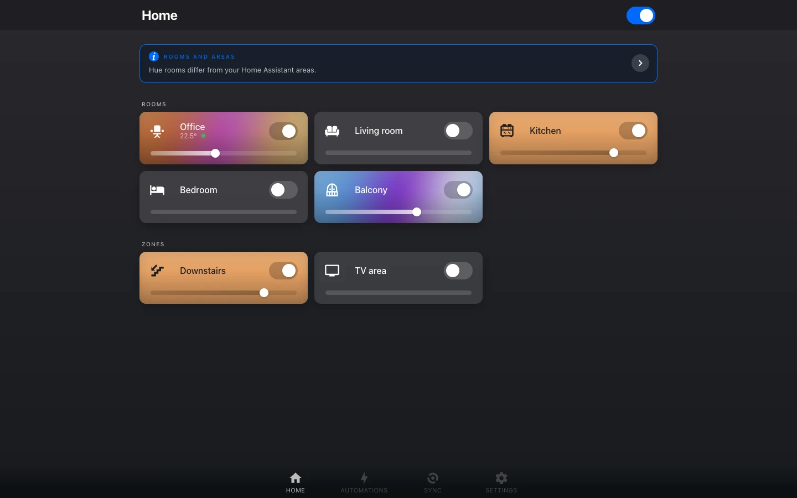

# Hue Studio

A Home Assistant custom integration that brings the look and feel of the Philips Hue app
to Home Assistant — a color wheel with draggable light dots, a scene gallery, palettes,
multi-color gradients — and adds what the Hue app cannot do: Home Assistant logic such as
time-of-day phases, weather, seasons, presence and automations.

{ .shot }

Hue Studio **extends** the built-in [Philips Hue](https://www.home-assistant.io/integrations/hue/)
integration instead of replacing it. Lights, scenes and sensors stay with the native
integration; Hue Studio reuses its bridge connections, so no second pairing is needed. It
is added once and uses every bridge of the Philips Hue integration — a bridge added there
later is picked up by itself.

!!! warning "Early development"
    Every release is an alpha for now. In HACS, turn on "Show beta versions" for Hue Studio.

## What you get

- :material-palette: **[The panel](guide/panel.md)**

    A full-screen "Hue app" at `/hue`: your Home Assistant areas as rooms, Hue zones,
    scenes, the color wheel and every setting.

- :material-image-multiple: **[Scenes and gallery](guide/scenes.md)**

    142 gallery scenes, scenes of your own, dynamic playback, backups — all stored on the
    bridge, so the Hue app sees them too.

- :material-robot: **[Automations](guide/automations.md)**

    The Hue app's automations (wake up, go to sleep, motion, …) as Home Assistant
    automations, with natural light and the scene of the day.

- :material-television: **[Sync Box](getting-started/sync-box.md)**

    The Hue Play HDMI Sync Box in the same panel, paired directly or through the HACS
    integration.

- :material-view-dashboard: **[Dashboard cards](guide/cards.md)**

    Rooms, automations and the gallery on your own dashboards, and a Hue-style dialog for
    every Hue light.

- :material-cog: **[Services](reference/services.md)**

    Palettes, gradients, effects, scenes and zones for your own automations and scripts.

## Where to start

1. [Install Hue Studio](getting-started/installation.md) through HACS and add it.
2. Open **Hue** in the sidebar and look around [the panel](guide/panel.md).
3. Make your first [automation](guide/automations.md).
